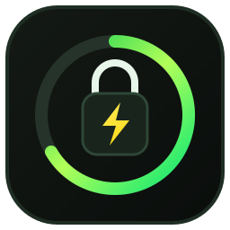
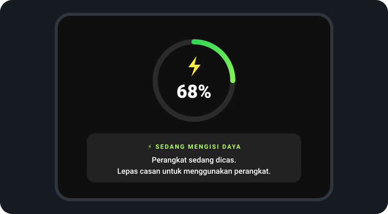
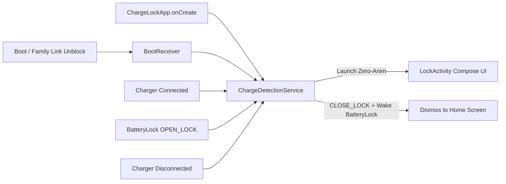

<p align="center">
  
</p>

<h1 align="center">ChargeLock</h1>

<p align="center">
  <b>Child-safe Android screen lock that prevents phones &amp; tablets from being used while charging — unlocking automatically the moment the charger is unplugged.</b>
</p>

<p align="center">
  
  
  
  
  
</p>

---

## Overview

**ChargeLock** is a lightweight, zero-distraction parental safety utility for Android phones and tablets. Playing games or watching videos while a device is plugged into a wall charger overheats the battery, damages USB-C ports, and poses electrical/thermal safety risks for children.

Whenever power is connected (`AC`, `USB`, or wireless), **ChargeLock** immediately presents a full-screen, non-dismissible charging overlay and blocks navigation keys (`Back`, `Home`, `Recents`). As soon as the charging cable is unplugged, the lock screen automatically dismisses and returns cleanly to the Home screen.

> **Companion Ecosystem**: Pair with [**BatteryLock**](https://github.com/Ravizikrillah/BatteryLock) (`≤ 20% → ≥ 50%` mandatory charge guard) for seamless, zero-flicker protection across both low-battery and active-charging states.

---

## Screen Preview

<p align="center">
  
</p>

---

## Key Features

- **Instant Power Detection (`AC` / `USB` / `Wireless`)**:
  - Persistent `specialUse` Foreground Service (`ChargeDetectionService`) monitors `ACTION_POWER_CONNECTED`, `ACTION_POWER_DISCONNECTED`, and `ACTION_BATTERY_CHANGED` (`EXTRA_PLUGGED` + `EXTRA_STATUS`).
  - Handles early USB-PD current negotiation without false dismissals.

- **Tamper-Resistant Child Lock**:
  - Immersive full-screen mode hiding Status Bar and Navigation Bar.
  - Intercepts **Back** (`BackHandler`), **Home** (`onUserLeaveHint`), and **Recent Apps / Focus Loss** (`onWindowFocusChanged` & `onPause` task reordering).
  - Displays over the system keyguard (`setShowWhenLocked(true)`).

- **Stealth Launcher Footprint**:
  - Registered under `CATEGORY_INFO` + `excludeFromRecents="true"` — **invisible on the Home Screen, App Drawer, and Recent Apps** so children cannot accidentally tamper with it.

- **Google Family Link Ready**:
  - Appears as a standalone installed package (`com.ravi.chargelock`) inside the parent's **Google Family Link** console.
  - Automatically resumes monitoring upon device boot (`BOOT_COMPLETED`, `LOCKED_BOOT_COMPLETED`) or after being unblocked in Family Link (`MY_PACKAGE_UNSUSPENDED`).

- **Seamless Handoff with [BatteryLock](https://github.com/Ravizikrillah/BatteryLock)**:
  - Shares pixel-identical Compose geometry (`#0F0F0F` obsidian canvas, `220dp` animated arc, `54sp` live battery percentage) and zero-animation window transitions (`overridePendingTransition(0, 0)`) for flicker-free handoff when plugging/unplugging at low battery.

---

## Architecture



---

## Quick Install & One-Command ADB Setup

Build and install directly onto a connected Android tablet or phone with all required overlay and background exemptions pre-granted:

```bash
# 1. Build Debug APK
./gradlew assembleDebug

# 2. Install APK
adb install -r app/build/outputs/apk/debug/app-debug.apk

# 3. Grant Overlay, Notification, & OEM Background Exemptions (Samsung One UI / Xiaomi / etc.)
adb shell appops set com.ravi.chargelock SYSTEM_ALERT_WINDOW allow
adb shell appops set com.ravi.chargelock RUN_IN_BACKGROUND allow
adb shell appops set com.ravi.chargelock RUN_ANY_IN_BACKGROUND allow
adb shell pm grant com.ravi.chargelock android.permission.POST_NOTIFICATIONS
adb shell dumpsys deviceidle whitelist +com.ravi.chargelock

# 4. Start Monitoring Service Immediately
adb shell am start -n com.ravi.chargelock/.MainActivity
```

---

## Project Structure

```text
app/src/main/
├── AndroidManifest.xml
├── java/com/ravi/chargelock/
│   ├── ChargeLockApp.kt           # Auto-starts foreground service on process creation
│   ├── BootReceiver.kt            # Direct-boot & Family Link unsuspend receiver
│   ├── ChargeDetectionService.kt  # Real-time charging state monitor & BatteryLock bridge
│   ├── LockActivity.kt            # Full-screen immersive Compose charging lock UI
│   ├── MainActivity.kt            # Permission diagnostics & manual bootstrap screen
│   └── ui/theme/                  # Material 3 color & typography definitions
└── res/                           # Adaptive vector icons & zero-flicker lock theme
```

---

## Companion App

| App | Role | Family Link Control |
| :--- | :--- | :--- |
| **ChargeLock** *(this repo)* | Locks device **while charging** until cable is unplugged | Keep **Always Allowed** |
| [**BatteryLock**](https://github.com/Ravizikrillah/BatteryLock) | Locks device at **≤ 20%** until charged to **≥ 50%** | **Block** temporarily in Family Link during travel emergencies |

---

## License

Released under the [MIT License](LICENSE).
